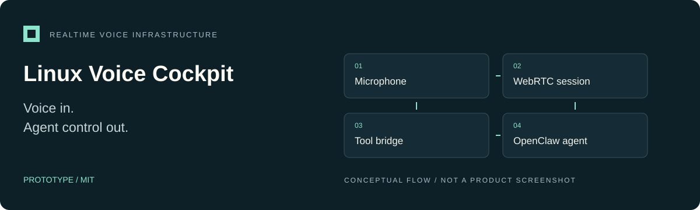

<p align="center"></p>

# Linux Voice Cockpit

**A typed, headless voice control plane connecting browser audio, realtime sessions, and OpenClaw agent tools.**

Prototype · MIT · [Project overview](docs/OVERVIEW.md) · [Website](https://alinaos-org.github.io/linux-voice-cockpit/) · [Landing-page source](docs/site/index.html)

## What it does

Linux Voice Cockpit connects realtime voice sessions to OpenClaw agent consult/control tools. The current implementation is a **typed, headless control plane with a loopback microphone canary**, not a packaged desktop application.

- Gateway-mediated realtime session admission through OpenClaw Talk.
- Browser WebRTC transport and realtime tool-call bridging.
- Redacted session-state projection for consuming clients.
- Explicit microphone, data-channel, peer, and session cleanup.
- Same-origin canary access and an allowlisted gateway RPC proxy.

## Develop locally

Use a current Node.js/npm toolchain capable of this TypeScript project. No minimum Node release is declared in the package; qualify your selected version.

```sh
git clone https://github.com/alinaos-org/linux-voice-cockpit.git
cd linux-voice-cockpit
npm ci
npm run check
npm test
```

These commands build and test the local code. They do not prove that a provider account can create a realtime session.

## Try the microphone canary

You need a compatible OpenClaw gateway with Realtime Talk configured, a
gateway token, and microphone access in the browser. Provider authentication
is owned by the gateway; the cockpit never reads OpenClaw's SQLite or JSON auth
stores. Do not put tokens in committed files.

| Variable | Purpose |
| --- | --- |
| `OPENCLAW_GATEWAY_TOKEN` | Required gateway credential, retained server-side |
| `OPENCLAW_GATEWAY_URL` | Gateway WebSocket endpoint; defaults to the local gateway |
| `COCKPIT_REALTIME_MODEL` | Optional model preference passed to `talk.client.create` |
| `COCKPIT_REALTIME_VOICE` | Optional voice preference passed to `talk.client.create` |
| `COCKPIT_SESSION_KEY` | The one session admitted by the canary proxy |
| `COCKPIT_PORT` | Local canary port; default `4280` |

```sh
# Run only after supplying the gateway token through a protected environment source.
npm run canary
```

Open the loopback address printed by the service on the same machine and select
**Start microphone**. The only supported admission path is OpenClaw Gateway
Talk: the gateway returns an ephemeral Realtime credential and the browser uses
it for the WebRTC SDP exchange. The gateway's provider configuration determines
credential selection and billing. This project does not claim a particular
billing route without separate live, account-side evidence.

## Architecture

The browser owns capture and WebRTC transport. The service owns the gateway
credential and exposes a narrow Gateway Talk proxy. Realtime consult/control
events bridge to the selected OpenClaw session; a redacted projection reports
state to clients.

The browser receives only the gateway-minted ephemeral Realtime credential; it
is not given durable provider credentials or the gateway token. This design
boundary is not a claim that the prototype has received an independent security audit.


## Documentation

- [Desktop audio protocol](docs/desktop-audio-protocol.md)
- [Live Linux canary and acceptance criteria](docs/live-linux-canary.md)
- [Third-party realtime integration](docs/gpt-live-third-party-integration.md)
- [Clean-room requirements](docs/clean-room-product-requirements.md)
- [Desktop/mobile integration plan](docs/agentic-desktop-mobile-integration-plan.md)

Plans describe future integration, not delivered desktop or mobile clients.

## Status and contributions

**Prototype.** Live authentication, audio behavior, current SDK compatibility, and billing must be qualified on the intended installation. Local tests are not live-account acceptance. Keep the canary loopback-only; use synthetic data in tests and redact provider responses in bug reports.

For changes, run `npm run check` and `npm test`, describe the transport/lifecycle behavior affected, and include any separately performed live canary evidence.

## License

[MIT](LICENSE).
